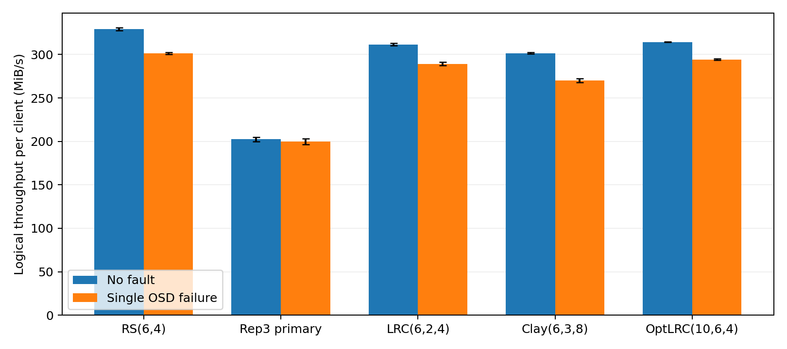

# Ceph EC profiles with a Gray–Scott HPC workload

Measurements, configurations, analysis scripts, and provenance for CloudLab experiments comparing RS, replication 3, Ceph LRC, Clay, and a restricted OptLRC implementation.

**Start with [the selected-trial comparison](summaries/COMPARISON.md), [methodology and limitations](docs/METHODOLOGY.md), and [the metric dictionary](docs/METRICS.md).** Results describe the tested configurations; they do not isolate coding algorithms at equal redundancy.



## Experiment

- 14 CloudLab d430 hosts: node0–node11 provide 24 BlueStore OSDs, two per host; node12–node13 are dedicated clients.
- Ceph Reef 18.2.8, ceph-ansible deployment; three MONs, one MGR, and one standby MDS (the workload uses RBD, not CephFS).
- Data placement intentionally uses **OSD failure domain**. Multiple chunks can be on OSDs of the same physical host. Metadata pools use host failure domain and replication 3/min_size 2.
- Two concurrent clients, eight MPI ranks/client, 100 histogram bins. Each client processes three complete passes of the same checksum-verified input: 3,600 steps, U/V double arrays of 256³, **900 GiB of field payload per pass**.
- Single-OSD fault: stop osd.3 on node4 after approximately 280 seconds; retain the 600-second automatic down/out interval. Repair and subsequent OSD restoration are separate measurements.
- Natural caches; no automatic cache dropping. Scrubbing observations and configuration/topology differences are retained.

| Configuration | Total shards/copies | Data shards | Data min_size | Nominal data storage factor |
|---|---:|---:|---:|---:|
| RS(6,4) | 10 | 6 | 7 | 1.667× |
| Replication 3, primary-only | 3 copies | — | 2 | 3× |
| Ceph LRC(6,2,4) | 10 including local parity | 6 | 7 | 1.667× |
| Clay(6,3,8) | 9 | 6 | 7 | 1.5× |
| OptLRC(n=10,k=6,r=4), local-only decoder | 10 | 6 | 9 | 1.667× |

Storage factors exclude filesystem, metadata, padding, snapshots, and outputs. Equal shard counts do not imply equal fault tolerance. OptLRC's `m=4` is also explicit Reef capacity-accounting metadata; it does not establish four-failure tolerance.

## Find a run

```text
results/<profile>/<no-fault|fault-osd3>/trial-XX/
  trial.json                 canonical selection and trial metrics
  README.md                  inclusion/exclusion information
  cluster/                   original cluster observations and recovery events
  node12/                    results.json, performance.csv.gz, plot.png,
                             pass-01..03-throughput.csv.gz and logs
  node13/                    same files for the second client
configurations/              configuration and software provenance per profile
summaries/                   selected-trial tables and comparison figures
telemetry/                   continuous OSD-host counters, stored once per campaign
provenance/                  source inventory, input hashes, historical runners
diagnostics/                separate read-policy and OptLRC correctness checks
```

There are **31 retained main-campaign trials, of which 30 are selected**: three no-fault and three fault trials per configuration. Each trial is one experimental repetition; its two clients are not independent repetitions.

**OptLRC selection:** use fault source trials **01, 03, 04**. Trial **02 is retained but excluded** because archive relocation shared the experimental network during its third pass. Trial 04 is the replacement. Trial numbers preserve their original identities.

**Replication read-policy checks:** [diagnostics/replicated-read-policy](diagnostics/replicated-read-policy) contains a separate primary/balanced/balanced/primary comparison. Do not combine balanced no-fault measurements with the original primary-only fault campaign.

## Reproduce the analysis

Python 3.10 was used for collection; plotting requires the Matplotlib version recorded in `requirements.txt`.

```bash
python3 -m pip install -r requirements.txt
python3 analysis/summarize.py --plot
python3 analysis/plot_io.py --all
python3 tools/validate_bundle.py
```

CSV and JSONL logs are losslessly gzip-compressed. For example:

```bash
gzip -dc results/optlrc/fault-osd3/trial-04/node12/performance.csv.gz | head
sha256sum -c SHA256SUMS
```

`SHA256SUMS` describes the prepared snapshot. Regenerating figures with different software may change their checksums without changing measurements. Historical cluster controllers in `provenance/` contain original environment paths and operational commands; they are references, **not a portable deployment entry point**. The analysis commands above do not connect to or modify a cluster.

## Scope and provenance

- [Methodology](docs/METHODOLOGY.md): selection rules, stopping policies, comparison limits, and known data-quality issues.
- [Metrics](docs/METRICS.md): units, throughput definitions, recovery intervals, and timing limitations.
- [Provenance](docs/PROVENANCE.md): software identifiers, collected source files, transformations, and excluded large artifacts.
- `provenance/file-sources.json` maps collected artifacts to source paths and hashes. Raw JSON retains original timestamps, paths, and occasional stale display labels. Canonical configuration labels come from `configurations/`; figures use those labels without editing the measurements.

This repository intentionally excludes the 900 GiB input itself, large BP5 output directories, backup archives, plugin binaries, credentials, and keyrings. Original inputs/backups remain in the research environment. The input manifests permit verifying a separately obtained dataset. The OptLRC binary is identified by SHA-256 and its source references; the binary has not been republished here.
