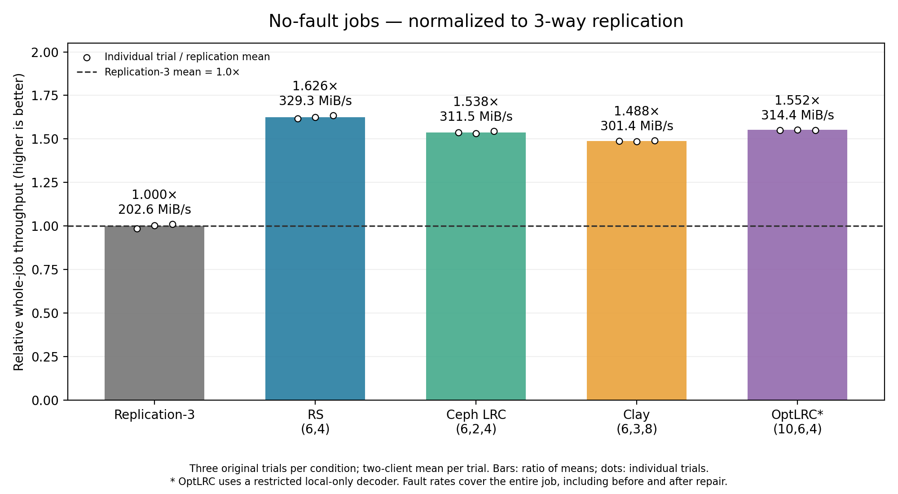
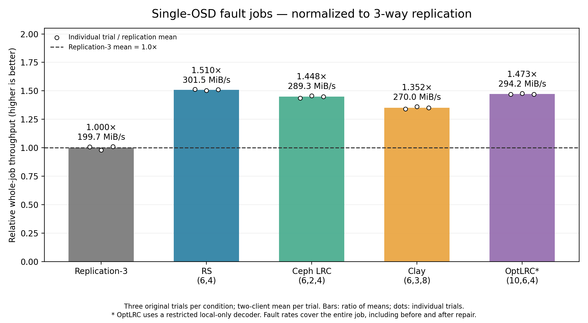

# Throughput relative to replication-3

Whole-job logical throughput per client, using the original three selected trials per condition. Each trial first averages its two clients; the bars divide the profile mean by the replication-3 mean for the same condition. Replication is 1.0× separately in each figure. Higher values indicate higher throughput.

White dots show all three trial means divided by the same replication mean, not paired trial ratios or confidence intervals. Original three-trial references are retained for every profile; the new OptLRC trials with changed memory settings are not mixed into this comparison.

| Configuration | No-fault relative throughput | Fault relative throughput |
|---|---:|---:|
| replicated-3 | 1.000× | 1.000× |
| reed-solomon | 1.626× | 1.510× |
| lrc | 1.538× | 1.448× |
| clay | 1.488× | 1.352× |
| optlrc | 1.552× | 1.473× |

Fault throughput covers the complete workload, including the periods before injection and after repair. It does not represent throughput only while OSD3 is out, maximum sustained drop, or slowdown against the same profile without fault. Throughput is logical application data / total job wall time, including compute and output, not read-phase-only bandwidth. Absolute units are MiB/s; ratios are dimensionless.

OptLRC uses a restricted local-only decoder. Configuration/PG/cache/scrub differences limit algorithm-level causal conclusions; see ../../docs/METHODOLOGY.md.

Each figure is available as PNG, SVG and PDF. Exact means and ratios are in profile-summary.csv; all 30 trial values are in individual-trials.csv; method-and-provenance.json records source hashes and selection.

Reproduce: `python3 analysis/plot_normalized_throughput.py`.
