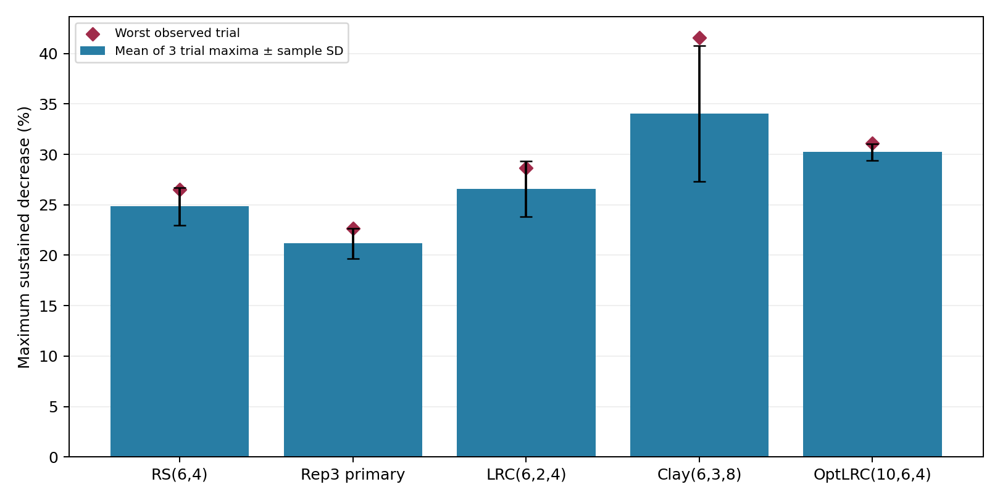

# Maximum sustained read-throughput decrease

Primary metric: maximum **30-second** time-weighted aggregate RBD read-throughput decrease during confirmed OSD down to repair completion. Every fault window uses both clients on the same wall-clock interval. Baseline reference is progress-conditioned, as detailed below.

| Configuration | Mean of 3 trial maxima ± sample SD | Worst observed | Trials |
|---|---:|---:|---|
| reed-solomon | 24.8% ± 1.9 pp | 26.5% | 1,2,3 |
| replicated-3 | 21.2% ± 1.5 pp | 22.7% | 1,2,3 |
| lrc | 26.6% ± 2.7 pp | 28.7% | 1,2,3 |
| clay | 34.0% ± 6.8 pp | 41.6% | 1,2,3 |
| optlrc | 30.2% ± 0.8 pp | 31.1% | 1,3,4 |

## Rules fixed before calculating maxima

- Only selected trials; replication is primary-only; OptLRC faults 01/03/04.
- Fault-search interval t_down → t_healthy; phase-specific and post-repair OSD-down results are secondary.
- Three-second grid; 10/30/60-second windows. Counter rates weighted by actual interval overlap; missing samples are not zero.
- Window must fit within one pass on each client, with six seconds trimmed from pass starts/ends. Entire window needs counter coverage; no exclusion based on how low its rate looks.
- Same rule for reference windows. Normal pass dips remain in plots and whole-job throughput.

## Progress-reference approximation

The existing application CSVs do not contain per-step wall-clock timestamps. Progress is therefore inferred from cumulative RBD reads normalized within each recorded pass; application CSVs establish 3600 steps and 900 GiB per pass. Check progress-proxy-audit.csv for measured coverage and read-byte ratios. This does not establish exact simulation-step alignment.

For each client, pass, and fault-window progress midpoint, eligible no-fault windows within ±1 percentage point of normalized progress are used. Their median throughput is calculated within each no-fault trial/client, client medians are summed, and the three trial estimates are averaged. Thus the reference is a synthetic progress-conditioned aggregate, not necessarily an observed simultaneous baseline window. Each fault window must have reference support from all three no-fault trials and both clients.

## Interpretation

These are observed sustained decreases, not proof that failure alone caused every difference. Search maxima depend on window size, temporal correlation, reference variation, cache state, and background activity. Trial maxima and sample SD describe three repetitions; clients and overlapping windows are not independent repetitions. Percentage and absolute-MiB/s maxima can select different windows; both are in trial-maxima.csv. No clipping of negative decreases or exclusion of genuine zero-throughput fault windows is applied.

A recovery subphase shorter than the requested window, such as remapping, has no valid whole-phase maximum; it is not reported as zero. Windows crossing recovery phases remain eligible for the primary metric and have combined phase labels.

## Outputs

- trial-maxima.csv: percentage and absolute maxima, UTC windows, phases, passes, progress, rates, and baseline range.
- profile-summary.csv: 10/30/60-second and phase sensitivity summaries.
- windows/: accepted and rejected candidate windows with reasons, losslessly compressed.
- exclusion-counts.csv and progress-proxy-audit.csv: denominator/support audit.
- plots/: primary 30-second rolling measurements with pass-transition shading and worst windows.
- method.json: exact parameters and reference definition.

## Completed audit

All 180 selected client/pass progress estimates passed the stated counter-coverage and byte-ratio requirements. RBD/logical read ratios ranged from 0.9991824 to 1.0002142. Of 26,202 primary 30-second candidate windows, 26,004 were accepted and 198 were excluded at pass transitions/guards; none were excluded for missing counter coverage or missing reference support. All 30 primary percentage/absolute peak records passed an independent direct raw-interval integration, boundary, event, arithmetic and extrema check.

